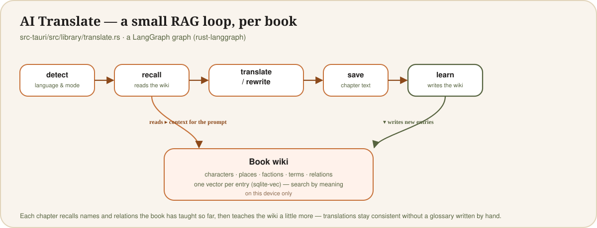

<p align="center">
  
</p>

<p align="center">
  <a href="#english">English</a> · <a href="#tiếng-việt">Tiếng Việt</a>
</p>

<a id="english"></a>
## English

**BenNovel** is an offline-first novel reader built with **Tauri v2** (desktop + Android/iOS) and **React + TypeScript**. There is no account and no server: you import your own book files, and everything — the text, your reading history, your AI translations, your dictionary lookups — lives in one SQLite file on your device.

### ✨ Popular features

| | |
| --- | --- |
| 🧠 **AI Translate** | Translate or rewrite a chapter — or queue the whole book in the background — with **your own** LLM key (OpenAI, Gemini, DeepSeek, OpenRouter, Claude, or any OpenAI-compatible endpoint, including a local Ollama/LM Studio). Pick a target language, a style (Literal, Natural, Literary, Casual), and whether to apply the book's glossary. The key never leaves your device. |
| 📥 **Import** | Bring in EPUB, PDF, DjVu, TXT, CHM, MOBI, AZW3, PRC, FB2, DOCX, ODT, RTF, HTML/MHTML and Markdown — a single file, or a whole folder (each file becomes a chapter, ordered the way you'd expect). Scanned PDF/DjVu pages are read with on-device OCR (Tesseract) so they become real, searchable, translatable text. |
| 📖 **Dictionary & reading tools** | A quick word lookup in the reader (today: a small sample dictionary; full AI lookup is wired up next), plus a per-book, per-language **glossary** and **find → replace** list, font/theme/spacing controls, and a book **wiki** (below). |

### 🧵 How AI Translate learns as it goes (RAG)

The more of a book the AI translates, the better it gets at the book's own names — because it builds and reads back its own notes as it goes:

<p align="center"></p>

Each chapter is a run through a small [LangGraph](https://github.com/langchain-ai/langgraph) graph (the Rust port, [`rust-langgraph`](https://crates.io/crates/rust-langgraph), in [`translate.rs`](src-tauri/src/library/translate.rs)):

1. **detect** — names the book's language and picks translate vs. rewrite.
2. **recall** — pulls the wiki entries this chapter is likely to need: by name/alias, and by **meaning**, via vector similarity search ([`sqlite-vec`](https://github.com/asg017/sqlite-vec)) over embeddings from your own embedding model.
3. **translate / rewrite** — the chapter, with that context in the prompt.
4. **save** — the result is stored; it's never used as input to a later translation.
5. **learn** — the model reads the chapter it just produced back through tool calls (`wiki_search`, `wiki_upsert`, `wiki_relate`) and grows the book's **wiki**: characters, places, factions, items, terms and how they relate — in every language, kept in sync.

That wiki is what **recall** reads next chapter — a small retrieval-augmented loop, local to your device, with no glossary to write by hand. See [`wiki.rs`](src-tauri/src/library/wiki.rs) for the full mechanics (what the user edits, the AI only adds to; what's removed, stays removed).

### 🛠 Stack

| Layer | What's in it |
| --- | --- |
| UI | React 19, TypeScript, Vite, hand-rolled stack-based router (no react-router) |
| Shell | Tauri v2 — one codebase to desktop (Linux/macOS/Windows) and mobile (Android/iOS) |
| Storage | `rusqlite` (bundled SQLite), one file per device under the user's app data — no server |
| Retrieval / AI memory | `sqlite-vec` for vector search over the book's wiki; embeddings from the same LLM API you set for translation |
| AI pipeline | `rust-langgraph` (LangGraph for Rust), talking to any OpenAI-compatible chat + embeddings API over `ureq` |
| Book formats | `epub`, `pdfium-render` (PDF), `djvu-rs`, `libchm`, `zip` + `quick-xml` (DOCX/ODT/FB2/EPUB), `encoding_rs` (legacy encodings) |
| OCR | Tesseract.js (`tesseract.js`), bundled and run entirely on-device |
| i18n | Interface in English and Vietnamese (`src/i18n/`); content languages EN/VI/ZH/KO |

### Running it

```bash
npm install
npm run dev            # frontend only, in the browser at http://localhost:1420
npm run tauri dev      # desktop app window
npm run tauri build    # desktop installer

# mobile (needs Android Studio / Xcode set up for Tauri)
npm run tauri android init && npm run tauri android dev
npm run tauri ios init && npm run tauri ios dev
```

On Linux, Tauri also needs the system WebKit packages: `libwebkit2gtk-4.1-dev libayatana-appindicator3-dev librsvg2-dev libxdo-dev libssl-dev`.

---

<a id="tiếng-việt"></a>
## Tiếng Việt

**BenNovel** là app đọc truyện hoạt động offline, xây bằng **Tauri v2** (desktop + Android/iOS) và **React + TypeScript**. Không tài khoản, không máy chủ: bạn tự nhập file truyện của mình vào, và mọi thứ — nội dung truyện, lịch sử đọc, bản dịch AI, tra từ điển — đều nằm trong 1 file SQLite ngay trên máy bạn.

### ✨ Tính năng nổi bật

| | |
| --- | --- |
| 🧠 **Dịch AI** | Dịch hoặc viết lại một chương — hoặc xếp hàng dịch cả truyện chạy nền — bằng **API key của chính bạn** (OpenAI, Gemini, DeepSeek, OpenRouter, Claude, hoặc bất kỳ endpoint tương thích OpenAI nào, kể cả Ollama/LM Studio chạy tại chỗ). Chọn ngôn ngữ đích, văn phong (Sát nghĩa, Tự nhiên, Văn chương, Đời thường), và có áp dụng bảng thuật ngữ hay không. API key không bao giờ rời khỏi máy bạn. |
| 📥 **Nhập sách** | Nhập EPUB, PDF, DjVu, TXT, CHM, MOBI, AZW3, PRC, FB2, DOCX, ODT, RTF, HTML/MHTML và Markdown — một file, hoặc cả thư mục (mỗi file thành một chương, xếp đúng thứ tự). Trang PDF/DjVu dạng ảnh scan được nhận dạng chữ ngay trên máy (OCR bằng Tesseract) để thành văn bản thật, tìm được và dịch được. |
| 📖 **Từ điển & công cụ đọc** | Tra nhanh một từ ngay trong màn hình đọc (hiện tại: một từ điển mẫu nhỏ; tra cứu AI đầy đủ đang được nối sẵn), cùng **bảng thuật ngữ** và danh sách **tìm → thay** riêng cho từng truyện/ngôn ngữ, tùy chỉnh font/giao diện/giãn dòng, và **wiki truyện** (xem bên dưới). |

### 🧵 Dịch AI "tự học" khi đọc tới đâu, nhớ tới đó (RAG)

Truyện càng được dịch nhiều, AI càng dịch tên riêng của truyện đó chuẩn hơn — vì nó tự ghi chú lại và tự đọc lại chú thích của chính mình:

<p align="center"></p>

Mỗi chương đi qua một đồ thị [LangGraph](https://github.com/langchain-ai/langgraph) nhỏ (bản port sang Rust, [`rust-langgraph`](https://crates.io/crates/rust-langgraph), trong [`translate.rs`](src-tauri/src/library/translate.rs)):

1. **detect** — nhận diện ngôn ngữ gốc của truyện, chọn dịch hay viết lại.
2. **recall** — lấy ra các mục trong wiki mà chương này nhiều khả năng cần: theo tên/biệt danh, và theo **ngữ nghĩa**, bằng tìm kiếm vector tương đồng ([`sqlite-vec`](https://github.com/asg017/sqlite-vec)) trên embedding từ chính model embedding bạn đã cấu hình.
3. **translate / rewrite** — dịch chương, với phần ngữ cảnh đó đưa vào prompt.
4. **save** — lưu kết quả; kết quả này không bao giờ được dùng làm đầu vào cho lần dịch sau.
5. **learn** — model đọc lại chính chương vừa dịch xong, qua các tool call (`wiki_search`, `wiki_upsert`, `wiki_relate`), rồi bồi đắp thêm cho **wiki** của truyện: nhân vật, địa danh, phe phái, vật phẩm, thuật ngữ và quan hệ giữa chúng — đồng bộ ở mọi ngôn ngữ.

Wiki đó chính là thứ **recall** sẽ đọc lại ở chương kế tiếp — một vòng lặp truy xuất-tăng-cường (RAG) nhỏ gọn, chạy ngay trên máy bạn, không cần tự tay viết bảng thuật ngữ. Xem chi tiết cơ chế trong [`wiki.rs`](src-tauri/src/library/wiki.rs) (mục nào bạn đã sửa tay, AI chỉ được bổ sung thêm; mục nào bạn đã xoá, sẽ không bị thêm lại).

### 🛠 Công nghệ sử dụng

| Lớp | Gồm những gì |
| --- | --- |
| Giao diện | React 19, TypeScript, Vite, router tự viết dạng stack (không dùng react-router) |
| Vỏ ứng dụng | Tauri v2 — một codebase cho desktop (Linux/macOS/Windows) và mobile (Android/iOS) |
| Lưu trữ | `rusqlite` (SQLite đóng gói sẵn), mỗi máy một file trong thư mục dữ liệu app — không có server |
| Truy xuất / bộ nhớ AI | `sqlite-vec` để tìm kiếm vector trên wiki truyện; embedding lấy từ chính API LLM bạn đã cấu hình để dịch |
| Pipeline AI | `rust-langgraph` (LangGraph viết lại bằng Rust), gọi bất kỳ API chat + embeddings tương thích OpenAI nào qua `ureq` |
| Định dạng sách | `epub`, `pdfium-render` (PDF), `djvu-rs`, `libchm`, `zip` + `quick-xml` (DOCX/ODT/FB2/EPUB), `encoding_rs` (bảng mã cũ) |
| OCR | Tesseract.js (`tesseract.js`), đóng gói sẵn và chạy hoàn toàn trên máy |
| Đa ngôn ngữ | Giao diện tiếng Anh và tiếng Việt (`src/i18n/`); ngôn ngữ nội dung EN/VI/ZH/KO |

### Chạy thử

```bash
npm install
npm run dev            # chỉ phần frontend, mở ở http://localhost:1420
npm run tauri dev      # cửa sổ app desktop
npm run tauri build    # tạo installer cho desktop

# mobile (cần cài sẵn Android Studio / Xcode cho Tauri)
npm run tauri android init && npm run tauri android dev
npm run tauri ios init && npm run tauri ios dev
```

Trên Linux, Tauri cần thêm các gói hệ thống: `libwebkit2gtk-4.1-dev libayatana-appindicator3-dev librsvg2-dev libxdo-dev libssl-dev`.

---

## Developer reference

*(kept in English, next to the code it documents)*

### Structure

```
src/
  data/        mock.ts (the built-in dictionary sample), repository.ts (book replace rules), types.ts
  store/       AppStore.tsx: navigation stack, reading language, reader prefs, the on-device library
  i18n/        en.ts, vi.ts, the provider and t()
  components/  NovelCover, BottomNav, LangDialog, ReaderTools, shared UI
  screens/     LibraryScreen, ProfileScreen, BookDetailScreen, LocalBookScreen (reader), WikiScreen
  styles/      organic.css (the Organic design system tokens) + app.css
src-tauri/     Tauri v2 shell (Rust): book/ (format readers), library/ (the on-device SQLite library,
               AI translate pipeline, wiki/RAG, sync & backup)
```

The interface is in English and Vietnamese (`src/i18n/`). It follows the device language at first, and you can switch it in Profile. The font is **Be Vietnam Pro**, bundled through `@fontsource`, so Vietnamese diacritics render correctly offline.

### Offline book files

In the native app, Library → **Open a book file** opens a book from the device (`src-tauri/src/book`).
Only the current section, the 2 after it and the 1 before it are kept in memory; the next ones are read in the
background and sections further away are freed (`KEEP_AHEAD` / `KEEP_BEHIND` in `book/mod.rs`).

| Format | How it is read |
| --- | --- |
| EPUB | One chapter per section, read from the ZIP on demand |
| PDF, DjVu | 10 pages per section; PDF via Pdfium, DjVu via its text layer (scans without OCR have no text) |
| TXT | ~64 KB per section ending at a line break; encoding from the BOM, else UTF-8, else GB18030/GBK |
| CHM | One page of the table of contents per section, decompressed on demand |
| MOBI, AZW3, PRC, FB2, DOCX, ODT, RTF, HTML, MHT/MHTML, Markdown | Text extracted once, streaming, to a plain file in the cache folder (deleted on close), then read in sections; headings start chapters |
| UMD | Not supported yet |

**Pictures.** A picture inside the text becomes a paragraph `U+FFFC + key`. The reader shows it as
`` from the app's `bookimg:` scheme (`book/commands.rs::serve_image`), so the bytes are
read from the book only when the picture scrolls into view and never travel through IPC.

| Format | Pictures |
| --- | --- |
| EPUB, CHM | `` / SVG `<image>` read from the archive on demand |
| PDF, DjVu | Each page drawn as a JPEG at screen width (Pdfium / djvu-rs); the reader has a **Pages / Text** switch |
| MOBI, AZW3, PRC | Picture records (`recindex`, `kindle:embed`) |
| FB2 | `<binary>` pictures, including the cover |
| DOCX, ODT | Pictures in the ZIP (`word/media`, `Pictures/`) |
| HTML, Markdown | Files linked by relative path next to the book, and `data:` URIs |
| MHT/MHTML | Picture parts of the archive (by `Content-Location` or `cid:`) |
| RTF | PNG and JPEG `\pict` data (WMF/EMF are skipped) |

Pictures of extracted formats are saved next to the extracted text in the cache folder and deleted with it.

### On-device library (SQLite)

Library → **Import a book** copies a book file into a SQLite database on the device, one file per user
(`<app data>/library/<email or guest>.sqlite3`, code in `src-tauri/src/library`). The tables
(`languages`, `authors`, `novels`, `novel_translations`, `chapters`, `chapter_translations`,
`glossary_entries`, `reading_history`, `replace_rules`, `wiki_*`) hold everything the app needs; there is no server.

- The import reads the file one section at a time; each section becomes a chapter with its original text
  (paragraphs separated by a blank line), all in one transaction.
- The language is guessed from the text (Hangul → ko, Chinese → zh, Vietnamese letters → vi, else en) and
  the author is "Unknown" until it can be edited.
- Reading a library book loads chapters from SQLite through the same in-memory window as a book file, and
  `reading_history` keeps the part and scroll position. The navigation's **Continue** reopens whichever
  imported book was read last, at the place you stopped.
- Pictures are copied into a local-only `chapter_images` table. For PDF and DjVu a copy of the file is kept in
  `<user>.files/` next to the database, so pages can still be drawn as pictures.
- **Open without saving** still reads a file directly without importing it.
- On Android the file picker lists every file (its type filter greys out MOBI, FB2, DjVu…), and the app tells
  the format from the file's first bytes.
- The app registers for the book types (`bundle.fileAssociations` in `tauri.conf.json`), so "Open with
  BenNovel" or tapping a book in a file manager opens it in the reader (`src-tauri/src/opened.rs`).
- **Backup & restore** (Profile) writes the whole library to one gzipped file and merges a backup back in
  row by row, so nothing made since is lost (`src-tauri/src/library/sync.rs`).

PDF text comes from [Pdfium](https://github.com/bblanchon/pdfium-binaries), loaded at runtime from next to
the app, its resources folder (`pdfium/`) or the system. The release workflow ships it with the Linux and
Android builds. To run the PDF test: `PDFIUM_DIR=/path/to/pdfium/lib cargo test` in `src-tauri`.

### Releases (Linux + Android)

`.github/workflows/release.yml` builds a Linux AppImage/.deb and an Android APK.
Push a version tag (matching `version` in `src-tauri/tauri.conf.json`) to publish a GitHub Release:

```sh
git tag v0.1.0 && git push origin v0.1.0
```

Or, without git: Actions → **Build & Release** → **Run workflow** on `main`, with `version` set to e.g. `v0.1.0`.

Android signing: set repo secrets `ANDROID_KEYSTORE_BASE64`, `ANDROID_KEYSTORE_PASSWORD`, `ANDROID_KEY_ALIAS`
to sign with your own key. Without them the APK is signed with a temporary test key, so a newer build
cannot update an installed one in place (uninstall first).
